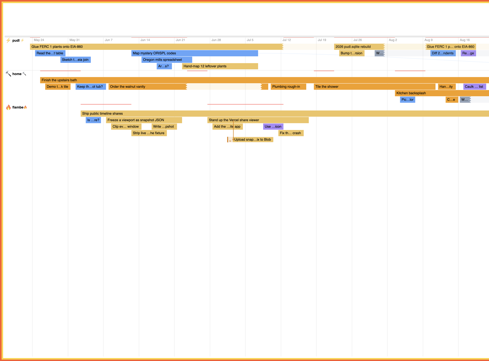

<p align="center">
  
</p>

<h1 align="center">Flambé</h1>

<p align="center"><strong>See where the work actually went.</strong></p>

<p align="center">
  A glorified todo app with delusions of being a profiler.<br />
  Flambé turns human and agent work into a live flame chart, so rabbit holes look like rabbit holes instead of mysteriously becoming 4:37 PM.
</p>

<p align="center">
  <a href="https://github.com/davvidbaker/flambe/actions/workflows/phase-0.yml"></a>
  <a href="https://www.npmjs.com/package/@davvidbaker/flambe-cli"></a>
  <a href="LICENSE"></a>
  
</p>

<p align="center">
  <a href="https://flambe-share.vercel.app"></a>
  <a href="#run-it-locally"></a>
</p>

<p align="center">
  <a href="#what-is-flambé">What is it?</a> ·
  <a href="#run-it-locally">Quick start</a> ·
  <a href="#connect-coding-agents">Agents</a> ·
  <a href="#host-your-own-instance">Self-host</a> ·
  <a href="#develop-from-this-repo">Develop</a> ·
  <a href="#docs">Docs</a>
</p>

<p align="center">
  <a href="https://flambe-share.vercel.app">
    
  </a>
</p>

<p align="center"><em>Actual Flambé UI. No artist's conception of a task manager was harmed in the making of this screenshot.</em></p>

## What is Flambé?

Most task systems flatten work into a list. Real work is not a list. It is a stack of interruptions, detours, subtasks, half-useful investigations, agent runs, and the occasional miraculous return to the thing you meant to do.

Flambé keeps that shape.

Activities **nest** and sit on a **timeline**, the way a profiler shows a call stack. Start a task, descend into a subproblem, hand something to an agent, come back up, and the chart records the structure instead of politely pretending you followed the plan.

Coding agents can report into the same trace, so your work and their work share one flame.

| Instead of... | Flambé gives you... |
|---|---|
| A flat list of boxes | Nested activities with parent/child structure |
| "Where did the afternoon go?" | A timeline you can actually inspect |
| Agent work disappearing into terminal scrollback | Agent activity on the same chart as yours |
| Logging every tiny action | A high-level stack of meaningful work |
| Pretending rabbit holes did not happen | Extremely visible rabbit holes |

**[Open the live demo →](https://flambe-share.vercel.app)** and pan or zoom a real sample timeline in your browser.

## Run it locally

Local mode uses Node 22 and SQLite and binds to loopback only.

```sh
npm --prefix frontend ci
npm --prefix frontend run build:local
node cli/bin/flambe.mjs serve
```

Open **http://127.0.0.1:4001**. Sign-in accepts any password and opens the local user.

That is enough to use Flambé on one machine. If you later point agents at it, the process prints `FLAMBE_URL`, `FLAMBE_API_TOKEN`, and `FLAMBE_TRACE_ID` for you.

<details>
<summary><strong>Local mode details and escape hatches</strong></summary>

The command serves the built SPA from `backend/priv/static`. The npm CLI package does not ship those assets; pass `--static /path/to/backend/priv/static`, or run Vite against the local API with `VITE_API_URL=http://127.0.0.1:4001` in `frontend/.env.local`.

Cloud agents cannot reach loopback. [Host an instance](#host-your-own-instance) when they run elsewhere.

To copy selected history onto a hosted instance later:

```sh
flambe export work.json
flambe import work.json --url https://your-app.fly.dev --token flb_...
```

Import creates a **new** trace on that account, or skips it if that export was already imported. Tokens and credentials are not part of the file.

</details>

## Connect coding agents

Agents are optional. Flambé is still useful if the only chaotic process involved is you.

Install the CLI:

```sh
npm install -g @davvidbaker/flambe-cli
```

Create a token in **Settings → API tokens**. It is shown once; the server stores a SHA-256 hash. From a local Mix checkout, `mix flambe_next.create_api_token you@example.com "Claude"` also works.

In the project where the agent runs:

```dotenv
FLAMBE_URL=https://your-app.fly.dev
FLAMBE_API_TOKEN=flb_...
FLAMBE_TRACE_ID=1
# FLAMBE_THREAD=flambe
```

Then an agent can report meaningful work as a stack:

```sh
ACTIVITY_ID=$(flambe start "Inspect authentication flow")
flambe end "$ACTIVITY_ID" "Confirmed bearer-token path"
flambe message "Auth fix needs the session module refactored too; widening scope"
```

`start` nests under that agent's newest active activity unless you pass `--parent` or `--root`. `message` asks the reducer whether the work is still on track; it needs `OPENAI_API_KEY` on the server. Lifecycle commands (`start`, `end`, `suspend`, `resume`) work without a model.

Copy the `flambe-cli` skill into the agent product you use ([`.cursor/skills/flambe-cli`](.cursor/skills/flambe-cli), [`.codex/skills/flambe-cli`](.codex/skills/flambe-cli)) so agents treat the trace as a live stack instead of enthusiastically logging every shell command they have ever met.

Hosted agents can call the same commands over MCP at `/mcp` with `Authorization: Bearer <API_TOKEN>`. Browser login cookies do not authenticate the MCP endpoint. The server prefers MCP `2026-07-28` and retains legacy initialization compatibility during migration.

See the **[CLI README](cli/README.md)** for installation, Cloud secrets, and command details.

<details>
<summary><strong>Environment-variable rules</strong></summary>

Shell environment variables win over `.env`. Do not commit `.env`.

Do not put `FLAMBE_AGENT_ID`, `FLAMBE_AGENT_NAME`, or `FLAMBE_AGENT_PLATFORM` in `.env`. The CLI derives those from the session, and the reducer names unnamed agents.

</details>

## Host your own instance

Production Flambé is a Phoenix 1.8 app with PostgreSQL: invite-gated signup, one Machine, and in-memory agent presence. Fly.io is the deployment path this repo ships with (`Dockerfile` + `fly.toml`).

**[Host your own Flambé →](docs/SELF_HOSTING.md)** covers Fly setup, secrets, first login, GitHub deploys, and running the Docker image elsewhere.

For now, keep `fly scale count` at 1. A second Machine would split presence until that signal moves out of memory. Distributed systems remain undefeated.

## Develop from this repo

Requirements: **Node 22 LTS**, **Elixir 1.18 / OTP 27**, and **PostgreSQL**. Native Windows, macOS, and Linux are supported.

```sh
cd backend
mix deps.get
mix ecto.create
mix ecto.migrate
mix phx.server
```

In another terminal:

```sh
cd frontend
npm ci
npm run dev
```

Open **http://localhost:5173**, register, and you land on the default `Main` trace. Vite proxies API, auth, and socket requests to Phoenix at `http://localhost:4001`.

<details>
<summary><strong>Development notes</strong></summary>

On Windows, install Visual Studio Build Tools with the **Desktop development with C++** workload. `bcrypt_elixir` needs it, because apparently a todo app was not complicated enough. The repo's Windows scripts locate that toolchain.

The backend defaults to `localhost:5432` with `postgres` / `postgres`. Override with the usual `PG*` environment variables if yours differ.

On Windows, run `scripts\windows_setup.cmd` and then `mix phx.server`.

Local Mix omits `FLAMBE_INVITE_CODE` unless you set it. `mix flambe_next.seed_e2e` from `backend` seeds the browser-test account.

`npm run build` from `frontend` writes hashed assets into `backend/priv/static/assets`; Phoenix then serves the SPA at `http://localhost:4001`.

</details>

### Checks

```sh
cd backend && mix precommit
cd ../cli && npm test
cd ../frontend && npm run typecheck && npm run test:unit && npm run build && npm run test:smoke
```

On Windows, run `backend\scripts\windows_check.cmd` and then the frontend scripts above. CI runs backend checks, the CLI, Phoenix-served browser smoke, and a `MIX_ENV=prod` smoke job.

## Desktop status flame

A native helper shows whether agents have talked to Flambé in the last 30 seconds. It uses an outlined, orange, or blue sparkling flame over one SSE connection to `/api/agent-status/stream`.

- macOS: [`macos/FlambeMenuBar`](macos/FlambeMenuBar/README.md)
- Windows: [`windows/FlambeTaskbar`](windows/FlambeTaskbar/README.md)

## Docs

| Doc | What it is |
|---|---|
| [Host your own instance](docs/SELF_HOSTING.md) | Fly / Docker production |
| [Product principles](docs/PRODUCT_PRINCIPLES.md) | What Flambé owns vs. agent runtimes |
| [Glossary](GLOSSARY.md) | Shared product and call-stack vocabulary |
| [Docs index](docs/README.md) | ADRs, local database, release checklist |

## License

[MIT](LICENSE). Burn responsibly.
